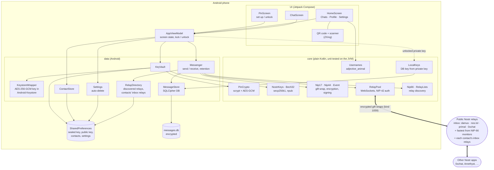
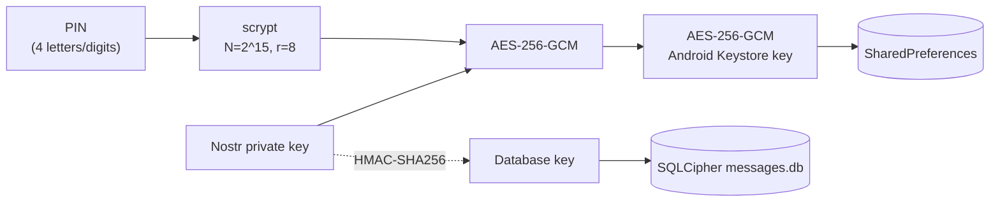
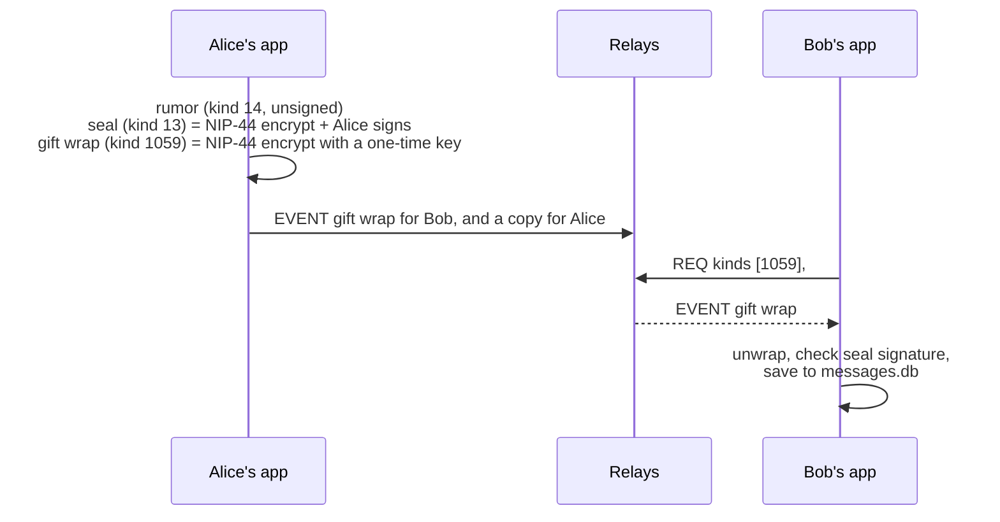

# Architecture

Nostr Chat is a single Android app with no backend of its own. Everything private stays
on the phone, and messages travel through public Nostr relays as encrypted gift wraps.

Messages only reach the screens through the database: `Messenger` writes every message it
receives or sends to `MessageStore`, then reloads the conversations from it.

## How the private key is protected

The private key exists only in memory after a correct PIN. The message database key is
derived from it, so the database can't be opened without the PIN either. Five wrong PINs
start a lockout that doubles each time, up to an hour.

The Keystore key can't be exported, so a copy of these files is useless on another
phone. To move phones, the app writes a backup file instead (`core/Backup.kt`):
`"NCBK" | version | scrypt params | salt | IV | AES-256-GCM(gzip(JSON))`, keyed with
scrypt (N=2^16, r=8) of a backup password. Restoring re-wraps the key under the new
phone's PIN and Keystore and re-inserts the messages into a fresh `messages.db`.

## How a message travels (NIP-17)

Relays only see a one-time key, the recipient's public key and a randomized timestamp.
They can't tell who sent a message or read what it says.

## Modules

| Module | What lives there |
| --- | --- |
| `core/` (`com.pbrajesh.mobile.nostrchat.core`) | Pure Kotlin: keys, bech32, PIN encryption, NIP-44, NIP-17, relay pool, retention. Tested with `./gradlew :core:test`. |
| `app/` (`com.pbrajesh.mobile.nostrchat`) | Android: Keystore, storage (SharedPreferences, SQLCipher), ViewModel, Compose screens, QR. |
| `.github/workflows/android.yml` | Runs the tests, sends a real message over public relays, and builds the debug APK. |
